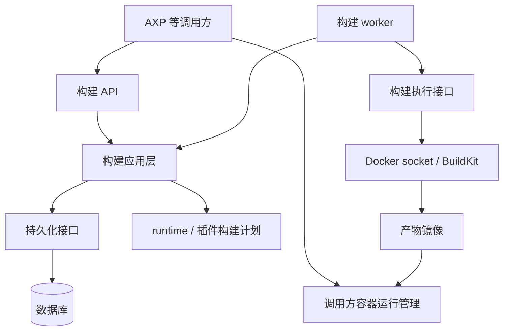

# 架构设计草案

## 服务边界

`sandboxed-agent-builder` 是有状态的异步镜像构建服务。调用方提供完整参数，服务保存构建记录并交付镜像，支持按构建 ID 轮询状态、读取日志、取消和重试。

AXP 等调用方拥有 Agent 身份、环境配置及版本、任务和运行决策。调用方保存构建参数、关联构建 ID 和镜像结果，负责容器启动、重启、环境切换、工作区和原生会话。builder 保存收到的规格快照用于审计和重试，不管理调用方的环境草稿或 Agent 生命周期。

服务需要数据库保存流程；Docker daemon 保存镜像和缓存。两者的状态需要核对，数据库中的成功记录不保证镜像永远不会被外部清理。

## 分层与模块



- 领域层：构建规格、尝试、状态转换、结果和幂等规则。
- 应用层：提交、领取、查询、取消、重试和重启后的核对。
- 构建计划模块：校验兼容性，锁定输入，生成镜像组装步骤与原生插件配置。
- 持久化 adapter：事务、worker 领取与租约、日志追加及查询。
- Docker adapter：构建、进度读取、取消及产物查询；内部使用 Docker/BuildKit 能力。
- API adapter：请求校验、认证、错误映射及分页。

领域和应用层不依赖 Docker 或数据库的具体类型。API 与 worker 可以先作为同一服务的不同模块部署；多 worker 时通过持久化领取机制协调，不能依赖进程内锁。

## 持久化模型

| 对象 | 保存内容 |
| --- | --- |
| BuildSpec | 不可变的完整参数快照、规格摘要、锁定的依赖与目标平台 |
| Build | 一次提交的 ID、调用方作用域、幂等键与规格引用 |
| BuildAttempt | 一次执行的状态、执行者、租约/代次、时间、取消请求及失败阶段 |
| BuildLog | 按尝试递增的序号、时间、阶段与日志内容 |
| ImageArtifact | 本地 image ID、daemon 引用、平台；可选 registry 引用及 digest |

同一个 Build 的重试创建新的 attempt，原尝试和日志保留。查询 Build 返回当前尝试及结果，支持查询历史尝试。

幂等键在调用方作用域内唯一，并绑定请求内容；重复键且内容不同应报冲突。规格摘要用于来源记录和缓存判断，不能代替幂等键：同一规格可以主动再次构建。

数据库至少持久化规格、尝试、状态、错误和产物元数据。初版日志可以按序号存入数据库，并定义大小和保留策略；将来改用外部日志存储时仍保留日志索引和读取契约。

## 构建规格与镜像组装

规格包含基础镜像、runtime/oar 版本、插件来源与版本、用户构建脚本、目标平台，以及可选输出方式。调用方的模型和指令只有在影响镜像内容时才作为构建输入。

具体产品选择和字段计划见 [构建契约](build-contract.md)：只支持 Codex；基础镜像为官方 Debian slim/完整 Debian（不提供 Alpine）；oar 新构建采用最新稳定版并锁定；build/startup 脚本分别定义。hook 兼容贡献到 akhook 上游。

基础系统与运行入口/oar → runtime → 按稳定顺序排列的插件安装步骤 → 用户构建脚本。

每个插件组织独立 layer，利用 BuildKit 缓存；前面的 layer 改动会使后续缓存失效。相同输入和平台可以复用缓存或已有产物，但强制重建的语义需明确。

锁定基础镜像 digest、runtime/oar 版本及插件内容。脚本下载的依赖也需锁定才能承诺可复现。记录原始请求与解析后的实际输入，缓存命中不代替来源记录。

启动脚本可以作为文件打包进镜像，实际执行由调用方的启动入口负责。builder 不提供启动脚本执行、工作区挂载或运行时凭据注入接口。

构建私有依赖使用临时 build secret，规格只保存引用。运行凭据由调用方提供。密钥不得进入镜像 layer、持久化参数或日志。

## 状态与失败处理

尝试状态：`queued → running → succeeded / failed / cancelled / interrupted`。

- 领取 queued 尝试需要事务和执行租约。旧 worker 的过期写入通过代次校验拒绝。
- 取消请求单独持久化；请求被接受不等于执行已经停止。只有确认停止才能标记 cancelled。
- 已成功完成的尝试不能被迟到的取消请求覆盖。
- 构建失败记录明确阶段、错误码和可读原因；重试保留旧失败历史。
- 产物确认完成后才记录成功；数据库写入失败或连接中断需要后续核对。

数据库不能让 Docker 构建自动跨服务重启续接。重启后核对已失去执行者的尝试：通过尝试专属的结果 tag/标签等执行证据确认产物；确认已完成才补录成功。无法确认的尝试标记 interrupted，后续显式重试并复用 Docker 缓存。

数据库租约不保证失联的 Docker 构建已经停止。恢复逻辑需要核对旧执行、尝试隔离和结果归属，避免将旧尝试的结果错误写入新尝试。不承诺 exactly-once 构建，也不隐式启动无限重试。

API 客户端断开不会取消已持久化的构建。worker 与 Docker 连接中断则需核对实际结果。服务重启前已经保存的日志可补查，未落库日志可能丢失，需要记录日志不完整的情况。

## 镜像交付

本地模式返回 `imageId`、目标平台和 daemon 引用。该 ID 对应的镜像必须存在于指定 Docker daemon，调用方在同一个 daemon 上运行它。

跨机器运行需要显式配置 registry 输出，构建成功包含推送成功，返回 `repository@sha256:…`。本地 image ID 与 registry manifest digest 不可混用。无 registry 时不承诺镜像可跨机器使用。

规划可选内置 Distribution registry，提供持久化单节点镜像分发；默认输出仍为本地镜像。registry 不自动暴露 daemon 镜像，产物需推送发布，网络地址与存储单独配置。

镜像仍在 Docker/registry 中；调用方保存产物引用。产物可能被外部清理，需定义可用性检查和清理协调；builder 不能自动删除仍被调用方使用的镜像。

## API 草案

| 接口 | 行为 |
| --- | --- |
| `POST /builds` | 提交完整规格及幂等键，持久化后返回 202 和 buildId |
| `GET /builds/:id` | 返回当前尝试、状态、取消请求、失败原因与镜像结果 |
| `GET /builds/:id/attempts` | 分页查询历史尝试 |
| `GET /builds/:id/logs?attempt=…&after=…` | 按尝试和序号增量分页读取日志，返回下一游标 |
| `POST /builds/:id/cancel` | 请求取消当前尝试；返回实际状态 |
| `POST /builds/:id/retry` | 在无活跃尝试时创建新尝试；请求也需要幂等键 |

调用方提交后轮询状态和日志，成功后保存镜像引用，自行部署。轮询断开后可继续查询，无需 builder 向 AXP 主动回调。正式契约需明确认证、调用方隔离、错误码、分页上限、日志保留及建议轮询间隔。

## oar 与插件

oar 是产物中的 runtime 驱动依赖，builder 不通过它开启会话。oar 不提供通用插件安装标准；插件组装需要生成所选 runtime 的原生配置。

提供构建支持的 runtime/插件兼容矩阵，无法满足的配置明确拒绝。运行时 hooks、审批、会话恢复需由调用方和产物集成验证；不因镜像构建成功就承诺这些能力可用。现有 AXP plugins-go 可评估复用，插件定义不重复复制进 prompt。

## 实现（Go + chi）

### 干净架构与最简实现

| | 最简实现（handler 直接调用 Docker 与 SQL） | 干净架构（采用） |
| --- | --- | --- |
| 代码量 | 少，单包即可 | 多出端口接口与装配代码 |
| 状态规则 | 散落在 handler 与 worker 中 | 集中在领域与应用层，状态转换、幂等、租约、取消、核对各有一处实现 |
| 测试 | 需要真实 Docker 与数据库 | 应用层用假执行器在真实 PostgreSQL 上测并发、取消、租约丢失与恢复 |
| 演进 | 换数据库或日志存储要改用例 | 新增 adapter（PostgreSQL、外部日志）不改用例 |

### 包结构

```text
cmd/builder                 composition root：配置、OTel、装配；serve / registry-gc
internal/domain             Build、Attempt、状态与转换、Failure、Artifact、错误
internal/app                用例（Service）、Worker（含重启核对）、日志写入；端口：Store、Resolver、Executor、Publisher
internal/spec               请求规格、默认值与校验（Policy）、锁定规格 Resolved、规范化哈希
internal/plugin             Agent Plugin 读取与校验，编译为 Codex 原生配置与 akhook 规则
internal/plan               构建上下文与 Dockerfile 生成、镜像入口脚本
internal/api                chi 路由、认证、错误映射、分页
internal/adapter/postgres   Store：goose 迁移、SKIP LOCKED 领取、租约代次、日志
internal/adapter/docker     Executor：Docker SDK + daemon 内置 BuildKit；镜像 digest；推送
internal/adapter/registry   内置 distribution/v3 registry 与 Publisher
internal/adapter/resolve    Resolver：基础镜像 digest、npm、Node.js、akhook 提交、插件
internal/adapter/gitsource  git CLI 拉取并锁定插件提交
internal/config             配置文件与 build secret 来源
```

依赖方向：`api`、`adapter/*` → `app` → `plan`、`spec`、`domain`。领域与应用层不引用 Docker、SQL 或 HTTP 类型。构建计划是只依赖 `Fetcher` 的纯函数，由 worker 直接调用。端口只保留在确实有第二种实现（测试替身或可替换的外部系统）的地方，取舍见 [ablation.md](ablation.md)。

### 数据库

只支持 PostgreSQL（17 起验证），驱动为 pgx。

- **迁移**：用 goose 管理，迁移文件嵌入二进制（`internal/adapter/postgres/migrations`），版本记录在 `goose_db_version`。启动时执行，并持有 goose 的 Postgres session lock，多个实例同时启动也只会迁移一次。
- **领取**：`UPDATE … WHERE id = (SELECT … ORDER BY created_at LIMIT 1 FOR UPDATE SKIP LOCKED) RETURNING id`。多个 builder 实例共享同一队列时互不阻塞；接管租约过期的尝试走同一条语句。
- **并发写**：
  - 取消与重试锁住对应的 build 行（`FOR UPDATE`）。
  - 日志追加锁住 attempt 行并校验租约，再用 `COPY` 批量写入。
  - 提交用 `INSERT … ON CONFLICT (caller, idempotency_key) DO NOTHING` 处理同键并发。
- **类型**：
  - 时间用 `timestamptz`，读出时统一转成 UTC。
  - 原始请求体用 `bytea`，原样保存。
  - 解析后的规格、失败信息、产物用 `jsonb`，可直接按 `failure->>'stage'` 查询。
  - 日志文本写入前去掉 NUL、替换非法 UTF-8，因为 PostgreSQL 的 `text` 不接受这两种内容。
- **部署拓扑**：多个 builder 实例可以共享同一个数据库，前提是它们使用同一个 Docker daemon。镜像产物和 attempt 的 tag 都在这个 daemon 里，核对时也要查它。

### 执行与恢复

- worker 在事务中把最早的 queued 尝试改为 running，代次加一，租约默认 30 秒，每 10 秒续期；续期同时取回取消请求。所有写入（日志、结果）都以 (attempt, worker, generation) 为条件，过期 worker 的写入返回 `ErrStaleLease` 并放弃。
- 构建经 Docker socket 劫持 `/grpc`、`/session` 连接 daemon 内置的 BuildKit（与 buildx docker driver 相同），用 moby exporter 写入 daemon 镜像库。每个尝试有专属 tag `sandboxed-agent-builder/<buildId>:<attemptId>` 和 build/attempt label。取消即取消 Solve 的 context；BuildKit 在客户端会话结束时停止构建，`Build` 在 Solve 返回后才返回。
- worker 定期（每个租约周期）接管租约过期的 running 尝试（代次加一，挡住旧 worker），在 daemon 中查该尝试的 tag 与 label，registry 模式再 `HEAD` manifest：确认则补录成功（`recovered`），否则 `interrupted`，等待显式重试。daemon 查询失败时不做判断，下一轮再试。
- 关闭：停止领取，立即停止仍在运行的构建并记为 interrupted；进程被强杀时由重启后的核对处理。

### registry

内置 registry 使用 `distribution/v3` 的 handler 与 filesystem 存储驱动，独立端口；可选 htpasswd 基本认证与 TLS。发布：daemon 打 `<publicHost>/<repository>:<attemptId>` tag 并推送，读取推送报告的 digest，再由 builder 对 registry `HEAD` 核对 digest 一致后才记成功，返回 `repository@digest`；任何一步失败记为 `publish` 阶段失败，保留本地产物。`publicHost` 必须是 daemon 可达的地址：builder 在容器中运行时，daemon 解析的是宿主机网络，示例部署因此使用 host 网络。builder 不删除 registry 内容；`builder registry-gc` 在 registry 停止时清理未引用的 blob（`-untagged` 同时清理无 tag 的 manifest）。本地镜像同样不自动删除，清理由运维按调用方仍在使用的引用决定。

### 其他决策

- worker 并发默认 2；租约 30 秒；日志每尝试 8 MiB；轮询间隔建议 2 秒（`Retry-After`）。
- 临时凭据：build secret 由运维在配置中声明来源（环境变量或文件），规格只引用 ID，在 builder 启动时读入（缺失即启动失败，变更需重启），执行时经 BuildKit session 提供，值在日志入库前脱敏，不进入数据库、规格或镜像层。运行凭据由调用方在启动容器时注入，见[运行契约](runtime-contract.md)。
- OTel：设置 `OTEL_EXPORTER_OTLP_ENDPOINT` 时导出 trace，每个尝试一个 `build.attempt` span，属性 `build.id`、`build.attempt.id`、`build.attempt.number`、`build.spec_digest`；结构化日志同样带 `build_id`、`attempt_id`。
- 认证：静态 bearer token（配置中保存 sha256），一个 token 一个调用方作用域。

验证结果见 [verification.md](verification.md)，API 见 [api.md](api.md)。
